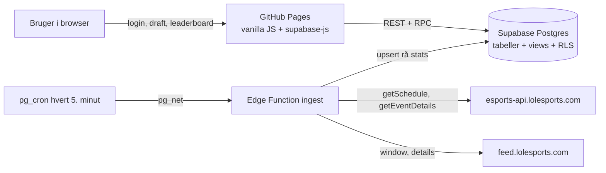

# Worlds Fantasy Draft

Et fantasy-spil til **League of Legends Worlds 2026**, som en vennegruppe (6–8 personer) spiller mod hinanden. Man drafter pro-spillere fase for fase, får point for spillernes **individuelle præstation**, og konkurrerer på et fælles leaderboard.

---

## Indhold

1. [Formål](#formål)
2. [Hvad spillet indeholder](#hvad-spillet-indeholder)
3. [Lavet med](#lavet-med)
4. [Arkitektur](#arkitektur)
5. [Projektstruktur](#projektstruktur)
6. [Game design-valg](#game-design-valg)
7. [Pointsystemet i detaljer](#pointsystemet-i-detaljer)
8. [UI- og UX-valg](#ui--og-ux-valg)
9. [Tekniske valg](#tekniske-valg)
10. [Datakilder](#datakilder)
11. [Validering](#validering)
12. [Drift og administration](#drift-og-administration)
13. [Kendte begrænsninger](#kendte-begrænsninger)
14. [Tidsplan for Worlds 2026](#tidsplan-for-worlds-2026)
15. [Kør lokalt](#kør-lokalt)
16. [Git-workflow](#git-workflow)

---

## Formål

- Give vennegruppen et fælles spil under Worlds, hvor **viden om spillet** belønnes mere end held.
- Lave et pointsystem, hvor **en sejr ikke trumfer personlig præstation**. En stærk spiller på et tabende hold skal kunne slå en svag spiller på vinderholdet.
- Skabe en **risk/reward-følelse**: underdogs kan score stort, mens sikre favoritter mest vinder gennem sejre.
- Være gratis at drive og kunne bygges på få dage.

---

## Hvad spillet indeholder

| Side | Indhold |
|---|---|
| **Login** | Brugernavn og password. Ingen e-mail kræves. |
| **Forside** | Worlds-status: kampprogram i dansk tid, stilling i den aktuelle fase, holdstats og de bedste spillere målt i fantasy-point. |
| **Fantasy draft** | Faser i rækkefølge (Play-In → Swiss → Kvartfinale → Semifinale → Finale). Hold vist efter power ranking, spillere som FIFA-kort, træk-og-slip eller klik ind på roller. Pris og pointsystem forklaret på siden. Knappen **Lock in** gemmer. |
| **Leaderboard** | Stilling i ligaen, ændring siden sidste kamp, og en tidslinje der viser, hvem der førte efter hver afsluttet serie. Opret eller join ligaer med en invitationskode. |
| **Mine hold** | Point pr. hold og pr. spiller, med seriepoint efter hver kamp. |

---

## Lavet med

| Del | Teknologi |
|---|---|
| Frontend | HTML, CSS og vanilla JavaScript (ES-moduler, ingen build-step) |
| Hosting | GitHub Pages |
| Database | Supabase Postgres 17 |
| Login | Supabase Auth (password) |
| Adgangskontrol | Row Level Security (RLS) i Postgres |
| Kampdata | Supabase Edge Function i TypeScript (Deno) |
| Planlægning | `pg_cron` + `pg_net` i Postgres |
| Klientbibliotek | `@supabase/supabase-js` 2.45.4 via jsDelivr |
| Skrifttyper | Barlow Condensed, Barlow og JetBrains Mono (Google Fonts) |
| Analyse og simulering | Python (pandas, numpy) – bruges kun under designet, ikke i drift |

---

## Arkitektur



**Dataflow:** lolesports → `ingest` gemmer rå kampstats → views regner point ud → frontend viser leaderboard og hold.

Tabellerne gemmer kun rå fakta. Alle point, totaler og stillinger beregnes i views, når de læses.

---

## Projektstruktur

```
index.html                      Appens skal: topnavigation og visningsområde
css/app.css                     Al styling (designtokens øverst)
js/
  config.js                     Supabase-URL, offentlig nøgle, tidszone
  api.js                        Al kommunikation med Supabase samlet ét sted
  ui.js                         Præsentation: escaping, datoer, visningsnavne, spillerkort
  app.js                        Opstart, login-tjek og skift mellem faner
  domain/                       Spillets regler som rene funktioner (testes uden browser)
    roles.js                    De fem roller
    phase.js                    Fasernes tilstand og aktuel fase
    series.js                   Serier, stilling, tidslinje og kampprogram
    draftRules.js               Draft-reglerne på klientsiden
  views/                        Én fil pr. side
    login.js · home.js · draft.js · leaderboard.js · mine.js
tests/                          Unit tests af domain/ (npm test)
supabase/
  functions/ingest/index.ts     Henter kampe og stats fra lolesports
  migrations/                   Databaseskemaet med samme numre som i Supabase
  seed/                         Opslagsdata, faser og kalibrering
analyse/                        Python-scripts fra simuleringen og kalibreringen
docs/ui-skitser.html            De godkendte UI-skitser
IMPROVEMENTS.md                 Refaktoreringer med før, efter og hvorfor
```

---

## Game design-valg

Hvert valg er listet med begrundelse og de alternativer, der blev fravalgt.

### Spilformat

| Valg | Begrundelse | Fravalgt |
|---|---|---|
| **Ny draft i hver fase** | Holder spillet levende hele turneringen. Man reagerer på, hvem der faktisk spiller godt. | Ét hold for hele turneringen; transfervinduer. |
| **Alle faser vægter lige** | Ingen fase afgør spillet alene. | Stigende vægt mod finalen. |
| **To hold i Swiss** | Swiss er den største fase med flest hold. To hold giver flere strategiske valg og mere spil i den længste periode. | Ét hold i Swiss. |
| **Swiss-point er summen af begge hold** | Swiss vægter derfor dobbelt, hvilket passer til, at fasen er den længste. | Snittet af de to hold. |
| **Play-In tæller med** | Giver spil fra første kampdag. | Play-In som ren test uden point. |
| **Finalen er fri leg** | Kun to hold er tilbage, så budget og holdgrænse giver ingen mening. Alle må vælge alle. | Budget i finalen. |
| **Alle brugere kan vælge samme spiller** | Det er brugerens samlede viden, der skal afgøre spillet, ikke hvem der drafter først. | Eksklusiv snake-draft. |
| **Ét hold pr. fase, som gælder i alle ligaer** | Man drafter kun én gang. En liga er bare en gruppe af brugere. | Ét hold pr. liga. |

### Regler for holdet

| Valg | Begrundelse | Fravalgt |
|---|---|---|
| **Én spiller pr. rolle** (top, jungle, mid, ADC, support) | Holdet ligner et rigtigt hold, og alle roller skal vurderes. | Frie pladser. |
| **Budget 100** (Play-In, Swiss, kvartfinale, semifinale) | Tvinger en blanding af favoritter og underdogs. | Intet budget. |
| **Højst 2 fra samme prohold** (3 i semifinalen; i Swiss talt på tværs af begge hold) | Forhindrer at man bare stabler favoritholdet. Semifinalen har kun fire hold, så grænsen hæves. | Ingen grænse. |
| **En spiller kan ikke stå på begge Swiss-hold** | De to hold skal være reelle alternativer. | Overlap tilladt. |
| **Kun startspillere** | En reserve, der aldrig kommer i kamp, ville give 0 point og føles som en fælde. | Hele rosteren inklusive reserver. |
| **Lock in gemmer, men kan ændres indtil fristen** | En for tidlig fejl skal ikke straffe. Fristen er første kamp i fasen. | Lock in er endelig. |
| **Andres hold kan først ses efter fristen** | Ingen kan kopiere en vens hold. | Åbne hold. |

### Priser

| Valg | Begrundelse | Fravalgt |
|---|---|---|
| **Pris pr. hold, ikke pr. spiller** | Enkelt at forstå og at sætte. Alle fem spillere på et hold koster det samme. | Individuelle spillerpriser. |
| **Swiss: 4 prisklasser** – Favorit 26 · Stærk 22 · Middel 18 · Underdog 14 | Sat ud fra region og regional placering. Spredningen gør underdogs attraktive. | Faste priser for alle. |
| **Knockout: 2 prisklasser** – Favorit 23 · Underdog 17 | Sat ud fra Swiss-resultatet. Det lille spænd betyder, at valget handler om, hvem man tror spiller godt. | 26/14 (for stort spænd i små faser). |
| **Play-In: 26 / 22 / 18 / 14** (KC, C9, FUR, MVK) | Samme skala som Swiss. Budgettet tvinger mindst ét underdog-valg. | – |
| **Prismodellen blev beholdt efter simulering** | Simuleringen på Worlds 2024 og 2025 viste, at viden belønnes stærkt uden prisjusteringer. | Dynamiske priser, der stiger og falder. |

### Fravalgte mekanikker

| Mekanik | Hvorfor den blev droppet |
|---|---|
| **Kaptajn** (dobbelt point) | Gør spillet til et gæt på én spiller i stedet for et helt hold. |
| **Coach** | Coachens indsats kan ikke måles med de data, der findes. |
| **Loyalitetsbonus** | Simuleringen viste, at den kun flyttede 2–3 % af pointene. Den gav kompleksitet uden effekt. |
| **Transfers mellem kampe** | Erstattet af en ny draft i hver fase. |
| **Stats på spillerkortet** | Kortet viser kun navn, rolle og pris, så valget bygger på brugerens egen viden. |

---

## Pointsystemet i detaljer

### Point pr. kamp

```
Kampscore = 20 + 10 · z_rolle( 0,5 · z(Del A) + 0,5 · z(Del B) ) + MVP/ACE
```

- **20** er en gennemsnitlig kamp for rollen. Bedre giver flere, dårligere giver færre.
- **z_rolle** måles mod rollens eget snit, så en support og en ADC kan sammenlignes.
- **MVP/ACE: +3** til den bedste på vinderholdet og +3 til den bedste på taberholdet.

| Del | Hvad den måler | Inspiration |
|---|---|---|
| **Del A** | Kills, assists og deaths med rollevægte, plus afvigelse fra rollesnittet i CS/min, skadeandel, kill participation og wards. Ganges med en rollefaktor, gulv på −5, +5 % ved sejr, +2 for 10+ kills eller assists (ikke support). | LCS- og CBLOL-fantasy |
| **Del B** | Afvigelse fra rollesnittet i killandel, kill participation, deaths, CS/min, skadeandel og wards. | OP.GG, U.GG, DeepLoL og Tracker.gg |
| **Junglerens objectives** | Junglen får et lille tillæg pr. objective holdet tager: drage +0,5, elder +1, baron +1. | Ønske om at belønne objective-kontrol uden at give hele æren til én spiller. |

### Fra kamp til score

| Niveau | Beregning | Hvorfor snit og ikke sum |
|---|---|---|
| **Seriepoint** | Snittet af spillerens kampe i serien | En Bo5 må ikke give mere end en Bo1. |
| **Fasepoint** | Snittet af spillerens serier i fasen | Et hold, der ryger ud tidligt, kan stadig give mange point. Kun præstation tæller. |
| **Holdpoint** | Summen af de fem spilleres fasepoint | |
| **Brugerens score** | Summen af alle hold: Play-In, Swiss A, Swiss B, kvartfinale, semifinale og finale | |

### Kalibrering

- Rollesnit, spredninger og vægte er **låst fra Worlds 2025-data** før turneringen. Pointene ændrer sig derfor ikke, fordi en anden spiller gør det godt.
- Konstanterne ligger i tabellerne `calibration`, `calibration_role` og `calibration_metric`.

---

## UI- og UX-valg

| Valg | Begrundelse |
|---|---|
| **Kun PC-browser** | Træk og slip og en bred holdvisning fungerer bedst på en stor skærm. |
| **Mørk esports-stil inspireret af lolesports.com** | Genkendelig stemning for målgruppen. Der bruges ingen logoer eller grafik fra Riot. |
| **Spillerkort i FIFA-stil** | Kortets kant viser prisklassen: guld er favorit, sølv stærk, bronze middel og grå underdog. |
| **Hold sorteret efter lolesports' power ranking** | Den rækkefølge kender brugerne i forvejen. |
| **Træk og slip, plus klik som alternativ** | Klik og tastatur (Enter) gør draften brugbar uden mus. Shift+klik sender kortet til Swiss-hold B. |
| **Forklaring af point og priser på draft-siden** | Brugeren skal forstå reglerne i det øjeblik, valget træffes. |
| **Regler tjekkes live** | Budget, holdgrænse og manglende roller vises, mens man bygger, og knappen er låst, indtil holdet er gyldigt. |
| **Alle tider i dansk tid** | Worlds 2026 spilles i Nordamerika. Tiderne gemmes i UTC og vises i Europe/Copenhagen, så sommertidsskiftet den 25. oktober håndteres korrekt. |
| **Leaderboard med tidslinje** | Viser, hvem der førte efter hver serie. Det giver historie og spænding, ikke kun en slutstilling. |
| **Typografi** | Barlow Condensed til overskrifter (esports-præg), Barlow til tekst og JetBrains Mono til tal, så kolonnerne flugter. |
| **Farver** | Næsten sort baggrund, cyan som accent, guld for førstepladsen og grøn/rød kun for status (sejr/tab, gyldig/ugyldig). |

De godkendte skitser ligger i [`docs/ui-skitser.html`](docs/ui-skitser.html).

---

## Tekniske valg

### Database

| Valg | Begrundelse |
|---|---|
| **Tabellerne er i 3. normalform** | Hvert fakta står ét sted, så data ikke kan blive uenige. |
| **Drager i egen tabel** (`game_dragon`) | 1NF: feedet leverer dem som en liste, og lister må ikke stå i en celle. |
| **Pris via prisklasse** (`team_price` → `price_tier`) | 3NF: prisen afhænger af prisklassen, ikke af holdet. |
| **Spillerens hold og rolle kun i `roster`** | Undgår at samme fakta står i kampstatistikken og kan blive uenige. |
| **Kampens vinder gemmes én gang** (`game.winner_team_id`) | En "vandt"-kolonne på begge hold ville gemme det samme to gange. Seriens vinder tælles fra kampene. |
| **Alle point og totaler som views** | Intet afledt gemmes. Retter Riot en stat, regnes alt om automatisk. |
| **`fantasy_pick` er i 3NF, men ikke BCNF** | Rollen er en del af nøglen, så databasen selv sikrer præcis én spiller pr. rolle. |
| **`v_game_score` bruger en MATERIALIZED CTE** | Uden den gentog planlæggeren beregningen for hver række (17 s). Nu tager det ca. 40 ms. |

**Tabeller:**

| Gruppe | Tabeller |
|---|---|
| Opslag | `role`, `dragon_type`, `price_tier`, `metric` |
| Kalibrering | `calibration`, `calibration_role`, `calibration_metric` |
| Turnering | `tournament`, `phase`, `pro_team`, `player`, `tournament_team`, `roster`, `team_price`, `series`, `series_team`, `game`, `game_team`, `game_dragon`, `game_player` |
| Brugere | `profile`, `league`, `league_member`, `fantasy_team`, `fantasy_pick` |

**Views:** `v_game_player` → `v_game_score` → `v_series_points` → `v_phase_points` → `v_fantasy_pick_points` → `v_fantasy_team`, samt `v_player_card`, `v_series`, `v_team_stats` og `v_player_stats`. Funktionen `league_standings(liga, tidspunkt)` giver stillingen på et vilkårligt tidspunkt.

### Sikkerhed

| Valg | Begrundelse |
|---|---|
| **Draften gemmes kun via RPC'en `submit_draft`** | Alle regler (frist, budget, roller, holdgrænse, startspillere, unikke spillere) tjekkes i én transaktion i databasen. Browseren kan ikke snyde. |
| **RLS på alle tabeller** | Turneringsdata kan læses af alle. Kun `ingest` kan skrive. Andres hold vises først efter fristen. |
| **Ligaer kun for medlemmer** | Man ser kun ligaer, man er med i. Man joiner med en invitationskode. |
| **Offentlig Supabase-nøgle i frontend** | Det er sikkert, fordi RLS styrer, hvad nøglen giver adgang til. |
| **Brugernavn i stedet for e-mail** | Simpelt for vennerne. Supabase kræver en e-mail, så brugernavnet bliver til `brugernavn@users.worldsfantasy.app`. |

### Kampdata

| Valg | Begrundelse |
|---|---|
| **Én Edge Function (`ingest`) er det eneste sted, der taler med Riot** | Ét ansvar ét sted. |
| **Idempotent: alt gemmes på Riots id'er** | Funktionen kan køres igen og igen uden dubletter. |
| **Kører hvert 5. minut via `pg_cron`** | Ingen ekstern server. Point opdateres kort efter hver kamp. |
| **Vinderen sættes ud fra seriens stilling (gameWins)** | Mere sikkert end at gætte ud fra tårne og guld. Tårne og inhibitors bruges kun som nødløsning, hvis flere kampe er åbne på én gang. |
| **Ukendte spillere oprettes som reserver** | En stand-in får sine kampe registreret, men kan ikke vælges i draften. |
| **Stopper efter 100 sekunder** | Holder sig under Edge Functions' tidsgrænse. Næste kørsel tager resten. |

### Frontend

| Valg | Begrundelse |
|---|---|
| **Vanilla JS uden build-step** | Kan lægges direkte på GitHub Pages og er let at læse. |
| **`api.js` er det eneste modul, der kender Supabase** | Lav kobling: visningerne kalder funktioner og får almindelige objekter tilbage. |
| **Én fil pr. visning** | Høj samhørighed: hver fil har ét ansvar. |
| **Al tekst fra databasen escapes** | Beskytter mod HTML-injektion via brugernavne og holdnavne. |
| **Regler i `domain/`, adskilt fra visningerne** | GRASP Information Expert og høj samhørighed: reglerne kan unit-testes uden browser. |

### Kodeprincipper

Koden følger samme principper som [ProgExam](https://github.com/SimAbild/ProgExam):

| Princip | Sådan ses det i koden |
|---|---|
| **Ansvar pr. fil** | Hver fil starter med `// Ansvar:` på én linje. |
| **Korte metoder, der læses som trin** | Fx `submit_draft`: `assert_draft_open` → `assert_draft_valid` → `save_draft`. |
| **Fulde navne** | Ingen forkortelser som `ph` eller `c`; tal har navne (`RUN_TIME_BUDGET_MS`). |
| **DRY** | Serie-logik, fase-regler og prisklasser findes ét sted hver. `submit_draft` bygger på `v_player_card`. |
| **GRASP** | `api.js` er en Pure Fabrication med lav kobling; `domain/` er Information Expert; `app.js` er Controller. |
| **Tests** | 20 unit tests med Nodes indbyggede testværktøj (`npm test`). |
| **Dokumenterede ændringer** | [IMPROVEMENTS.md](IMPROVEMENTS.md) med før, efter og hvorfor. |

---

## Datakilder

| Kilde | Brug | Status |
|---|---|---|
| **lolesports livestats-feed** (`feed.lolesports.com`) | Slutstats pr. kamp: kills, deaths, assists, CS, skadeandel, wards, drager, baroner og tårne. | Primær |
| **lolesports esports-API** (`esports-api.lolesports.com`) | Kampprogram, serier, hold, rosters og stilling. | Primær |
| **gol.gg** | Kontrol af stats. | Kontrolkilde |
| **Leaguepedia** | Har for streng rate limit til drift. | Fravalgt |
| **PandaScore** | Gratisplanen har ingen stats. | Fravalgt |

---

## Validering

| Test | Resultat |
|---|---|
| **Simulering på Worlds 2024 og 2025** | Brugere med viden om spillet slår tilfældige og naive strategier tydeligt. Prismodellen fungerer uden justeringer. |
| **Sejr mod præstation** | Blandingen af Del A og Del B plus MVP/ACE giver den ønskede risk/reward. Stærke spillere på tabende hold kan score højt. |
| **Databasens point mod Python-modellen** | To kampe fra Worlds 2025 giver præcis de samme point, også MVP og ACE. |
| **Ende-til-ende i browseren** | Login, draft med Lock in, liga, leaderboard og Mine hold er testet mod den rigtige database. |

---

## Drift og administration

Opgaver, der skal laves i hånden:

| Hvornår | Opgave |
|---|---|
| Før hver draft | Sæt prisklasse pr. hold i `team_price` og power ranking i `tournament_team.power_rank`. |
| Når holdene er kendt | Markér startspillere i `roster.is_starter`. |
| Når en bruger glemmer sit password | Nulstil det i Supabase-dashboardet under Authentication. |
| Kun én gang | Slå "Confirm email" fra i Supabase under Authentication → Sign In / Providers → Email. |

---

## Kendte begrænsninger

- **Pauser:** pauser trækkes ikke fra kampens længde endnu, så CS pr. minut bliver en smule for lav i kampe med lange pauser.
- **Glemt password:** brugeren kan ikke selv nulstille det, fordi der ikke er en rigtig e-mail.
- **Faseslut:** tidspunkterne for semifinale og finale er sat ud fra planen og skal justeres, når Riot offentliggør de præcise tider.
- **Pointene er altid live:** en sen rettelse fra Riot kan flytte en afsluttet stilling.

---

## Tidsplan for Worlds 2026

| Fase | Datoer | Draft låser |
|---|---|---|
| Play-In | 15.–18. okt | 15. okt kl. 20:00 |
| Swiss | 23.–26. og 28.–31. okt | 23. okt kl. 19:00 |
| Kvartfinale | 3.–6. nov | 3. nov kl. 23:00 |
| Semifinale | 7.–8. nov | 7. nov |
| Finale | 14. nov | 14. nov |

Alle tider er dansk tid.

---

## Kør lokalt

```bash
python3 -m http.server 8000   # appen på http://localhost:8000
npm test                       # unit tests (kræver Node 20+)
```

Åbn http://localhost:8000. Appen taler direkte med Supabase-projektet.

Databaseskemaet i `supabase/migrations` er en kopi. Den autoritative udgave er migrationshistorikken i Supabase-projektet.

---

## Git-workflow

| Branch | Formål | Deploy |
|---|---|---|
| `main` | Produktion. Det vennerne bruger. | GitHub Pages bygger automatisk fra `main`. |
| `dev` | Udvikling og test. Alt nyt laves her først. | Ingen. Testes lokalt. |

**Sådan laves en ændring:**

1. Arbejd på `dev`, eller lav en feature-branch ud fra `dev` (fx `feature/swiss-priser`), og merge den ind i `dev`.
2. Test lokalt med `python3 -m http.server 8000`.
3. Opret en pull request fra `dev` til `main`.
4. Merge pull requesten. Så går ændringen i produktion.

**Regler:**

- Der committes aldrig direkte på `main`.
- Commit-beskeder skrives på dansk og beskriver, hvad der ændres og hvorfor.
- Databaseændringer laves som en ny migration og kopieres til `supabase/migrations/` i samme pull request.

**Bemærk:** der er kun ét Supabase-projekt, så `dev` og `main` bruger den samme database. Databaseændringer skal derfor være bagudkompatible, indtil frontenden på `main` er opdateret.
