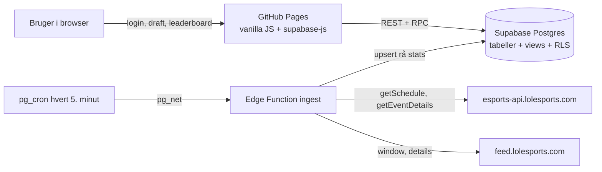

# Worlds Fantasy Draft

Et fantasy-spil til **League of Legends Worlds 2026**, som en vennegruppe (6–8 personer) spiller mod hinanden. Man drafter pro-spillere fase for fase, får point for spillernes **individuelle præstation**, og konkurrerer på et fælles leaderboard.

Hvert afsnit herunder starter med en **kort forklaring**. Vil du vide mere om valgene og hvorfor de blev taget, så fold **Uddybende forklaring** ud.

---

## Indhold

1. [Formål](#formål)
2. [Ordliste](#ordliste)
3. [Hvad spillet indeholder](#hvad-spillet-indeholder)
4. [Lavet med](#lavet-med)
5. [Arkitektur](#arkitektur)
6. [Projektstruktur](#projektstruktur)
7. [Game design-valg](#game-design-valg)
8. [Pointsystemet](#pointsystemet)
9. [Sådan trackes pointene](#sådan-trackes-pointene)
10. [UI- og UX-valg](#ui--og-ux-valg)
11. [Tekniske valg](#tekniske-valg)
12. [Validering](#validering)
13. [Drift og administration](#drift-og-administration)
14. [Kendte begrænsninger](#kendte-begrænsninger)
15. [Tidsplan for Worlds 2026](#tidsplan-for-worlds-2026)
16. [Kør lokalt](#kør-lokalt)
17. [Git-workflow](#git-workflow)

---

## Formål

**Kort forklaret:** Et gratis spil til vennegruppen under Worlds, hvor viden om spillet belønnes mere end held, og hvor en spillers egen præstation tæller mere end holdets sejr.

<details>
<summary><b>Uddybende forklaring</b></summary>

| Mål | Hvorfor |
|---|---|
| **Viden belønnes mere end held** | Spillet skal være sjovt for dem, der følger med i LoL esports. Den, der kender spillerne bedst, skal vinde over tid. |
| **En sejr trumfer ikke personlig præstation** | En stærk spiller på et tabende hold skal kunne slå en svag spiller på vinderholdet. Ellers handler spillet kun om at gætte vinderholdet. |
| **Risk/reward** | Underdogs kan score stort, mens sikre favoritter mest vinder gennem sejre. Det giver grund til at tage chancer. |
| **Gratis at drive og hurtigt at bygge** | Spillet bruges af få personer i én måned. Det skal kunne bygges på få dage og ikke koste noget at holde kørende. |

</details>

---

## Ordliste

**Kort forklaret:** Tekniske ord, der bruges i koden og i denne README.

<details>
<summary><b>Uddybende forklaring</b></summary>

| Ord | Betydning |
|---|---|
| **cron** | En tidsplan, der kører en opgave automatisk. Her kalder `pg_cron` funktionen `ingest` hvert 5. minut. |
| **Edge Function** | Et lille program, der kører på Supabase' server i stedet for i browseren. `ingest` er vores eneste. |
| **ingest** | At hente data udefra og gemme dem. Funktionen `ingest` henter kampe fra lolesports. |
| **feed** | lolesports' datastrøm med stats fra kampene, mens de spilles. |
| **view** | En gemt databaseforespørgsel, der kan læses som en tabel. Alle point regnes i views, så intet afledt gemmes. |
| **RPC** | En databasefunktion, som appen kalder direkte, fx `submit_draft`. |
| **RLS** (Row Level Security) | Regler i databasen for, hvem der må se og ændre hvilke rækker. |
| **upsert** | Indsæt rækken, eller opdatér den, hvis den allerede findes. |
| **idempotent** | Kan køres flere gange med samme resultat. `ingest` laver aldrig dubletter. |
| **migration** | En SQL-fil, der ændrer databasens opbygning. De ligger nummereret i `supabase/migrations`. |
| **seed** | Startdata, fx roller, priser og faser. Ligger i `supabase/seed`. |
| **3NF** (3. normalform) | Regel for tabeldesign: hvert fakta står ét sted, og intet afhænger af andet end nøglen. |
| **serie** | En kamp mellem to hold, spillet som Bo1, Bo3 eller Bo5 (bedst af 1, 3 eller 5 games). |
| **game** | Ét enkelt spil i en serie. |
| **fase** | Play-In, Swiss, kvartfinale, semifinale eller finale. |
| **prisklasse** (tier) | Favorit, Stærk, Middel eller Underdog. Bestemmer spillerens pris. |
| **slot** | Holdnummer i en fase. I Swiss har brugeren slot 1 og 2 (hold A og B). |
| **power ranking** | lolesports' Global Power Rankings: Riots egen rangering af alle hold. Bestemmer prisklassen og rækkefølgen på draft-siden. |
| **MVP / ACE** | Bedste spiller på vinderholdet (MVP) og på taberholdet (ACE) i et game. Begge får +3. |
| **z-score** | Hvor mange standardafvigelser en værdi ligger over eller under snittet. Bruges til at sammenligne roller. |
| **kill participation** (KP) | Andel af holdets kills, spilleren var med til (kills + assists). |
| **CS/min** | Minions og monstre dræbt pr. minut. |
| **domain** | Mappen med spillets regler som rene funktioner, adskilt fra siderne. |
| **prohold** | Et rigtigt hold i turneringen, fx T1 eller GEN. Brugerens egne hold kaldes bare "hold". |
| **pick** | Én spiller, som brugeren har valgt til en rolle på et af sine hold. |
| **appData** | Det, appen henter ved login og giver til alle sider: bruger, profil, turnering og faser. |
| **pageElement** | HTML-elementet `<main id="view">`, som den åbne side tegnes ind i. |
| **dialog** | Et vindue oven på siden. Bruges til at vise en anden brugers hold. Lukkes med Luk eller Escape. |
| **WCAG** | Den internationale standard for tilgængelighed på nettet. Vi sigter efter niveau AA. |
| **kontrast** | Forholdet mellem tekstens og baggrundens lysstyrke. WCAG kræver mindst 4,5:1 for almindelig tekst. |
| **skærmlæser** | Program, der læser siden højt for blinde og svagtseende. Det bruger fx `aria-label`. |

</details>

---

## Hvad spillet indeholder

**Kort forklaret:** Fem sider: **Login**, **Forside** med Worlds-status, **Fantasy draft** hvor man vælger sit hold, **Leaderboard** med stillingen og **Mine hold** med point pr. spiller.

<details>
<summary><b>Uddybende forklaring</b></summary>

| Side | Indhold | Hvorfor |
|---|---|---|
| **Login** | Brugernavn og password. Ingen e-mail kræves. | Vennerne skal ikke oprette sig med e-mail for at spille et spil i én måned. |
| **Forside** | Worlds-status: kampprogram i dansk tid, stilling i den aktuelle fase, holdstats og de bedste spillere målt i fantasy-point. | Man kan følge turneringen og finde formstærke spillere uden at forlade siden. |
| **Fantasy draft** | Faser i rækkefølge (Play-In → Swiss → Kvartfinale → Semifinale → Finale). Hold vist efter power ranking med en begrundelse for holdets prisklasse. Spillere som FIFA-kort med billede, træk-og-slip eller klik ind på roller. Forklaringen af point, priser og roller er foldet sammen og valgfri at læse. Knappen **Lock in** gemmer. | Her træffes alle valgene, så alt, man skal bruge for at vælge, står samme sted. |
| **Leaderboard** | Stilling for alle brugere, ændring siden sidste kamp, og en tidslinje der viser, hvem der førte efter hver afsluttet serie, og fasevindere: hvem der scorede flest point i hver fase. Tryk på en bruger for at se vedkommendes hold og holdnavne (når fasen er låst). | Konkurrencen mellem vennerne er spillets kerne. Tidslinjen og fasevinderne giver historie og ikke kun en slutstilling: man kan vinde en fase uden at vinde det hele. |
| **Mine hold** | Point pr. hold og pr. spiller, med seriepoint efter hver kamp. | Man kan se, hvilke valg der gav point, og lære til næste fase. |

</details>

---

## Lavet med

**Kort forklaret:** Vanilla JavaScript på GitHub Pages, og Supabase (Postgres, login, adgangsregler og en Edge Function) som backend. Det hele kører gratis og uden egen server.

<details>
<summary><b>Uddybende forklaring</b></summary>

| Del | Teknologi | Hvorfor |
|---|---|---|
| Frontend | HTML, CSS og vanilla JavaScript (ES-moduler, ingen build-step) | Filerne kan lægges direkte op uden byggeværktøj, og koden er let at læse. |
| Hosting | GitHub Pages | Gratis, og siden opdateres automatisk ved merge til `main`. |
| Database | Supabase Postgres 17 | En rigtig SQL-database med views, funktioner og transaktioner i en gratis plan. |
| Login | Supabase Auth (password) | Indbygget i Supabase, så der skal ikke bygges et loginsystem. |
| Adgangskontrol | Row Level Security (RLS) i Postgres | Reglerne for, hvem der må se og ændre hvad, ligger i databasen. Browseren kan ikke snyde. |
| Kampdata | Supabase Edge Function i TypeScript (Deno) | Henter kampe fra lolesports på serveren uden en egen server. |
| Planlægning | `pg_cron` + `pg_net` i Postgres | Databasen kalder selv `ingest` hvert 5. minut. Ingen ekstern cron-tjeneste. |
| Klientbibliotek | `@supabase/supabase-js` 2.45.4 via jsDelivr | Hentes fra en CDN, fordi der ikke er en build-step. Versionen er låst, så en ny udgave ikke kan ødelægge siden. |
| Skrifttyper | Barlow Condensed, Barlow og JetBrains Mono (Google Fonts) | Se UI- og UX-valg. |
| Analyse og simulering | Python (pandas, numpy) | Bruges kun til at designe og teste pointsystemet, ikke i drift. pandas er det letteste værktøj til at regne på tusindvis af kampe. |

</details>

---

## Arkitektur

**Kort forklaret:** lolesports → `ingest` gemmer rå kampstats → views i databasen regner point ud → frontenden viser leaderboard og hold. Der er ingen egen backend-server.

<details>
<summary><b>Uddybende forklaring</b></summary>



| Valg | Hvorfor | Fravalgt |
|---|---|---|
| **Ingen egen backend** | Browseren taler direkte med Supabase. RLS og RPC'en `submit_draft` sikrer, at ingen kan snyde. Det sparer en server, der skulle hostes og betales. | En Spring Boot- eller Node-server mellem browser og database. |
| **Tabellerne gemmer kun rå fakta** | Alle point, totaler og stillinger beregnes i views, når de læses. Retter Riot en stat, eller justeres en formel, regnes alt om af sig selv. | Gemte point, der skal genberegnes i hånden. |
| **Ét sted taler med Riot** | Kun `ingest` henter data udefra. Ændrer lolesports deres API, skal der kun rettes ét sted. | At browseren henter data fra lolesports direkte. |

</details>

---

## Projektstruktur

**Kort forklaret:** Frontenden ligger i `js/`. Filnavnene siger, hvad filen gør: `startApp.js` starter appen, `navigation.js` skifter mellem fanerne, og `database.js` henter og gemmer data. Hver fane har sin egen fil i `js/views/`, og spillets regler ligger i `js/domain/`. Databasen ligger i `supabase/`, og analysen af pointsystemet ligger i `analyse/`.

<details>
<summary><b>Uddybende forklaring</b></summary>

```
index.html                      Appens skal: topnavigation og visningsområde
css/app.css                     Al styling (designtokens øverst)
js/
  startApp.js                   Starter appen: login-tjek, henter appData, log ud
  navigation.js                 Skift mellem fanerne og advarsel om ugemte ændringer
  database.js                   Al kommunikation med databasen samlet ét sted
  config.js                     Supabase-URL, offentlig nøgle, tidszone
  domain/                       Spillets regler som rene funktioner (testes uden browser)
    roles.js                    De fem roller
    phase.js                    Fasernes tilstand og aktuel fase
    series.js                   Serier, stilling, tidslinje og kampprogram
    draftRules.js               Draft-reglerne på klientsiden
    phaseWinners.js             Hvem der scorede flest point i hver fase
  shared/                       Præsentation, som flere sider bruger
    displayText.js              Escaping, datoer, visningsnavne, prisklasser, fejl- og tom-bokse
    playerCard.js               Spillerkort og portræt
    teamSummary.js              Et brugerhold med point – deles af Mine hold og leaderboardet
  views/                        Én fil (eller mappe) pr. fane
    login.js · home.js · leaderboard.js · myTeams.js
    draft/
      draftPage.js              Henter data, husker sidens tilstand og tegner siden
      draftPageSections.js      HTML til sidens afsnit: faser, prohold, mine hold, Lock in
      howPointsWork.js          Teksten "Sådan får du point"
      pickPlayers.js            Vælg, træk, fjern og gem spillere
tests/                          Unit tests af domain/ (npm test)
supabase/
  functions/ingest/index.ts     Henter kampe og stats fra lolesports
  migrations/                   Databaseskemaet med samme numre som i Supabase
  seed/                         Opslagsdata, faser, kalibrering og Play-In 2026
analyse/                        Pointmodel, kalibrering og simulering i Python
docs/ui-skitser.html            De godkendte UI-skitser
docs/ux-gennemgang.md           UX- og tilgængelighedsgennemgang
IMPROVEMENTS.md                 Refaktoreringer med før, efter og hvorfor
```

| Valg | Hvorfor |
|---|---|
| **Filnavne efter hvad de gør, ikke efter teknisk mønster** | `navigation.js` frem for `router.js` og `database.js` frem for `api.js`. Man kan finde koden uden at kende fagudtrykkene. |
| **Én fil pr. side i `views/`, en mappe når siden er stor** | Hver fil har ét ansvar, så man ved præcis, hvor en side skal rettes. Draft-siden er delt i fire filer efter opgave. |
| **Regler i `domain/`, adskilt fra siderne** | Reglerne er rene funktioner uden DOM og Supabase, så de kan unit-testes uden browser. |
| **`database.js` er det eneste modul, der kender Supabase** | Siderne kalder funktioner og får almindelige objekter tilbage. Skifter databasen, skal kun én fil ændres. |
| **Delte stykker ligger i `shared/`** | Mine hold og leaderboardets dialog viser det samme hold, så koden står ét sted (DRY). |
| **Migrationer kopieres ind i repoet** | Skemaet kan læses og gennemgås sammen med koden, selvom Supabase er den autoritative udgave. |

</details>

---

## Game design-valg

**Kort forklaret:** Man drafter et nyt hold på fem spillere (én pr. rolle) i hver fase. Holdet skal holde sig inden for et budget på 100 og må højst have 2 spillere fra samme prohold. Prisen følger holdets placering i lolesports' power ranking. I Swiss har man to hold, og finalen er fri leg.

<details>
<summary><b>Uddybende forklaring</b></summary>

Hvert valg er listet med begrundelse og de alternativer, der blev fravalgt.

### Spilformat

| Valg | Begrundelse | Fravalgt |
|---|---|---|
| **Ny draft i hver fase** | Holder spillet levende hele turneringen. Man reagerer på, hvem der faktisk spiller godt. | Ét hold for hele turneringen; transfervinduer. |
| **Alle faser vægter lige** | Ingen fase afgør spillet alene. | Stigende vægt mod finalen. |
| **To hold i Swiss** | Swiss er den største fase med flest hold. To hold giver flere strategiske valg og mere spil i den længste periode. | Ét hold i Swiss. |
| **Swiss-point er summen af begge hold** | Swiss vægter derfor dobbelt, hvilket passer til, at fasen er den længste. | Snittet af de to hold. |
| **Play-In tæller med** | Giver spil fra første kampdag. | Play-In som ren test uden point. |
| **Finalen er fri leg** | Kun to hold er tilbage, så budget og holdgrænse giver ingen mening. Alle må vælge alle. | Budget i finalen. |
| **Alle brugere kan vælge samme spiller** | Det er brugerens samlede viden, der skal afgøre spillet, ikke hvem der drafter først. | Eksklusiv snake-draft. |
| **Ingen ligaer – alle er på samme leaderboard** | Spillet deles kun med en vennegruppe, så ligaer og invitationskoder var unødig kompleksitet. | Ligaer med invitationskode (bygget i første version og fjernet igen). |

### Regler for holdet

| Valg | Begrundelse | Fravalgt |
|---|---|---|
| **Én spiller pr. rolle** (top, jungle, mid, ADC, support) | Holdet ligner et rigtigt hold, og alle roller skal vurderes. | Frie pladser. |
| **Budget 100** (Play-In, Swiss, kvartfinale, semifinale) | Tvinger en blanding af favoritter og underdogs. | Intet budget. |
| **Højst 2 fra samme prohold** (3 i semifinalen; i Swiss talt på tværs af begge hold) | Forhindrer at man bare stabler favoritholdet. Semifinalen har kun fire hold, så grænsen hæves. | Ingen grænse. |
| **En spiller kan ikke stå på begge Swiss-hold** | De to hold skal være reelle alternativer. | Overlap tilladt. |
| **Kun startspillere** | En reserve, der aldrig kommer i kamp, ville give 0 point og føles som en fælde. | Hele rosteren inklusive reserver. |
| **Holdet skal have et navn** (fra Swiss) | Holdnavnet er en del af det sociale i spillet og vises på leaderboardet. Feltet starter tomt med teksten "Navngiv dit hold", og Lock in er låst, indtil holdet har et navn. | Standardnavnet "Mit hold". |
| **Lock in gemmer, men kan ændres indtil fristen** | En for tidlig fejl skal ikke straffe. Fristen er første kamp i fasen. | Lock in er endelig. |
| **Andres hold kan først ses efter fristen** | Ingen kan kopiere en vens hold. | Åbne hold. |

### Priser

| Valg | Begrundelse | Fravalgt |
|---|---|---|
| **Pris pr. hold, ikke pr. spiller** | Enkelt at forstå og at sætte. Alle fem spillere på et hold koster det samme. | Individuelle spillerpriser. |
| **Swiss: 4 prisklasser** – Favorit 26 · Stærk 22 · Middel 18 · Underdog 14 | Sat ud fra power ranking. Spredningen gør underdogs attraktive. | Faste priser for alle. |
| **Knockout: 2 prisklasser** – Favorit 23 · Underdog 17 | Sat ud fra power ranking efter Swiss. Det lille spænd betyder, at valget handler om, hvem man tror spiller godt. | 26/14 (for stort spænd i små faser). |
| **Play-In: 26 / 22 / 18 / 14** (KC #11, C9 #16, MVK #28, FUR #35 i power ranking 11. okt.) | Samme skala som Swiss. Budgettet tvinger mindst ét underdog-valg. | – |
| **Hver prisklasse har en skrevet begrundelse** | Brugeren skal kunne se, hvorfor et hold er Stærk og et andet Underdog. Begrundelsen står ved holdet i draften og ligger i `team_price.reason`. | Kun et tal uden forklaring. |
| **Prisklassen følger lolesports' Global Power Rankings**, når draften åbner | Én kilde, som alle kan slå op og tjekke. Ingen egen vurdering. | Region og seed (gav FUR en højere pris end MVK, selvom MVK er rangeret højere). |
| **Prismodellen blev beholdt efter simulering** | Simuleringen på Worlds 2024 og 2025 viste, at viden belønnes stærkt uden prisjusteringer. | Dynamiske priser, der stiger og falder. |

### Fravalgte mekanikker

| Mekanik | Hvorfor den blev droppet |
|---|---|
| **Kaptajn** (dobbelt point) | Gør spillet til et gæt på én spiller i stedet for et helt hold. |
| **Coach** | Coachens indsats kan ikke måles med de data, der findes. |
| **Loyalitetsbonus** | Simuleringen viste, at den kun flyttede 2–3 % af pointene. Den gav kompleksitet uden effekt. |
| **Transfers mellem kampe** | Erstattet af en ny draft i hver fase. |
| **Stats på spillerkortet** | Kortet viser kun billede, navn, rolle og pris, så valget bygger på brugerens egen viden. |
| **Tower damage til toplanere** | lolesports' feed har ikke skade på tårne pr. spiller, kun antal tårne pr. hold. Et tillæg for holdets tårne ville belønne hele holdet og ikke toplaneren, og det ville kræve en ny kalibrering. |

</details>

---

## Pointsystemet

**Kort forklaret:**

- En spiller får **ca. 20 point** i en gennemsnitlig kamp for sin rolle. Bedre end rollens snit giver flere, dårligere giver færre.
- Hver rolle måles mod sit eget snit, så **alle roller er lige meget værd**. Forskellen er, hvilke stats der giver point.
- Bedste spiller på vinderholdet (MVP) og på taberholdet (ACE) får **+3**.
- Seriepoint og fasepoint er **snit**, så flere spillede kampe giver ikke flere point.
- Din score er **summen af alle dine hold** i turneringen.

<details>
<summary><b>Uddybende forklaring</b></summary>

### Point pr. kamp

```
Kampscore = 20 + 10 · z_rolle( 0,5 · z(Del A) + 0,5 · z(Del B) ) + MVP/ACE
```

- **20** er en gennemsnitlig kamp for rollen. Bedre giver flere, dårligere giver færre.
- **z_rolle** måles mod rollens eget snit, så en support og en ADC kan sammenlignes.
- **MVP/ACE: +3** til den bedste på vinderholdet og +3 til den bedste på taberholdet.

| Del | Hvad den måler | Inspiration |
|---|---|---|
| **Del A** | Kills, assists og deaths med rollevægte, plus afvigelse fra rollesnittet i CS/min, skadeandel, kill participation og wards. Ganges med en rollefaktor, gulv på −5, +5 % ved sejr, +2 for 10+ kills eller assists (ikke support). | LCS- og CBLOL-fantasy |
| **Del B** | Afvigelse fra rollesnittet i killandel, kill participation, deaths, CS/min, skadeandel og wards. | OP.GG, U.GG, DeepLoL og Tracker.gg |
| **Junglerens objectives** | Junglen får et lille tillæg pr. objective holdet tager: drage +0,5, elder +1, baron +1. | Ønske om at belønne objective-kontrol uden at give hele æren til én spiller. |

| Valg | Hvorfor | Fravalgt |
|---|---|---|
| **To dele blandet 50/50** | Del A ligner klassisk fantasy (kills og assists giver point), Del B ligner stats-sider (hvor meget bedre end snittet). Blandingen belønner både de store øjeblikke og stabilt godt spil. | Kun klassisk fantasy, som favoriserer spillere med mange kills. |
| **z-score pr. rolle** | En support får aldrig lige så mange kills som en ADC. Måles hver rolle mod sig selv, er alle roller lige meget værd at vælge. | Samme pointtabel for alle roller. |
| **Sejr giver kun lidt** (+5 % af Del A) | Formålet er, at præstation trumfer sejr. Sejren tæller, men afgør ikke alene. | Fast bonus for sejr. |
| **Gulv på −5 i Del A** | En katastrofal kamp må gerne koste, men ikke ødelægge en hel fase. | Intet gulv. |
| **MVP og ACE** | Giver også den bedste spiller på taberholdet en belønning, så stærke spillere på svage hold kan betale sig. | Kun MVP til vinderholdet. |

### Point pr. rolle

Alle roller giver **i snit lige mange point (20)**, fordi z-scoren regnes mod rollens eget snit. Ingen rolle er derfor bedre at vælge end en anden. Forskellen er, *hvilke* stats der giver pointene.

Vægtene herunder kommer fra `calibration_metric` og `calibration_role` (`supabase/seed/02_calibration_2025.sql`). **A** er vægten i Del A, **B** i Del B. Kills og assists tæller kun i Del A. "–" betyder, at stat'en ikke tæller for rollen.

| Stat | Top | Jungle | Mid | ADC | Support |
|---|---|---|---|---|---|
| Kills (A) | 3 | 2,5 | 3 | 3 | 2 |
| Assists (A) | 1,5 | 2 | 1,5 | 1 | 2 |
| Deaths (A og B) | −1 | −1 | −1 | −1,5 | −0,5 |
| CS/min (A og B) | 3 | – | 2,5 | 3 | – |
| Skadeandel (A og B) | 0,5 | – | 0,5 | 0,6 | – |
| Kill participation (A / B) | – / 0,2 | 0,3 / 0,5 | 0,15 / 0,3 | – / 0,2 | 0,4 / 0,6 |
| Killandel (B) | 0,6 | 0,4 | 0,6 | 0,7 | 0,2 |
| Wards placeret (A og B) | – | – | – | – | 0,1 |
| Wards ødelagt (A og B) | – | 0,3 | – | – | 0,3 |
| Rollefaktor (Del A) | 1,47 | 0,92 | 1,06 | 1,28 | 0,94 |
| Objectives | – | drage +0,5 · elder +1 · baron +1 | – | – | – |
| +2 for 10+ kills eller assists | ja | ja | ja | ja | nej |

Rollefaktoren ganges på Del A, før der regnes z-score mod rollens eget snit. Den ændrer derfor ikke rollens gennemsnit og giver ingen rolle en fordel.

**Hvad betyder det i praksis:**

- **Top:** kills og CS/min vejer tungest, plus skade og en stor andel af holdets kills.
- **Jungle:** kills, assists, kill participation og ødelagte wards, plus tillæg for holdets objectives. CS og skade tæller ikke.
- **Mid:** kills, CS/min og skade, plus andel af holdets kills.
- **ADC:** kills, CS/min, skade og killandel vejer tungest. Deaths koster mest af alle roller.
- **Support:** assists, kills, kill participation og wards. Deaths koster mindst. CS og skade tæller ikke.

**Hvorfor vægtene er forskellige:** hver rolle har sit eget job. En ADC skal farme og lave skade og har råd til færrest deaths. En support skal gå forrest, så deaths straffes mindst, mens vision og assists belønnes. CS og skade tæller ikke for jungle og support, fordi de ikke er rollens opgave.

### Fra kamp til score

| Niveau | Beregning | Hvorfor snit og ikke sum |
|---|---|---|
| **Seriepoint** | Snittet af spillerens kampe i serien | En Bo5 må ikke give mere end en Bo1. |
| **Fasepoint** | Snittet af spillerens serier i fasen | Et hold, der ryger ud tidligt, kan stadig give mange point. Kun præstation tæller. |
| **Holdpoint** | Summen af de fem spilleres fasepoint | |
| **Brugerens score** | Summen af alle hold: Play-In, Swiss A, Swiss B, kvartfinale, semifinale og finale | |

### Kalibrering

- Rollesnit, spredninger og vægte er **låst fra Worlds 2025-data** før turneringen. Pointene ændrer sig derfor ikke, fordi en anden spiller gør det godt.
- Konstanterne ligger i tabellerne `calibration`, `calibration_role` og `calibration_metric`.

| Valg | Hvorfor | Fravalgt |
|---|---|---|
| **Låst kalibrering fra året før** | En kamp giver de samme point i dag som efter finalen. Ellers ville gamle point flytte sig, hver gang nye kampe blev spillet. | Snit regnet løbende på Worlds 2026. |
| **Worlds 2025 som grundlag** | Seneste Worlds har samme niveau og meta-tempo som dette års turnering. | Regionale ligaer, hvor niveauet er et andet. |

</details>

---

## Sådan trackes pointene

**Kort forklaret:**

- Hvert 5. minut henter databasen selv nye kampe fra lolesports' officielle API og livestats-feed.
- Kun **færdige** kampe får stats, og kun **rå tal** gemmes (kills, deaths, CS osv.).
- Pointene regnes ud i databasen, hver gang en side vises. Derfor opdateres de kort efter hver kamp, og en rettelse fra Riot slår automatisk igennem.

<details>
<summary><b>Uddybende forklaring</b></summary>

### Trin for trin

Koden ligger i `supabase/functions/ingest/index.ts`.

| Trin | Hvad sker der | Hvorfor |
|---|---|---|
| **1. Tidsplan** | `pg_cron` kalder `ingest` via `pg_net` hvert 5. minut (`supabase/migrations/007_cron_ingest.sql`). | Ingen ekstern server. Point er klar få minutter efter en kamp. |
| **2. Kampprogram** | `getSchedule` henter alle Worlds-kampe for året (leagueId `98767975604431411`). Hver kamp gemmes som en `series`. | Kampprogrammet på forsiden og fristerne i draften kommer herfra. |
| **3. Er der noget nyt?** | `hasNewInformation` springer serier over, der ikke er startet, eller som allerede har alle stats og vindere. | Holder kørslen kort og skåner lolesports for unødige kald. |
| **4. Seriens detaljer** | `getEventDetails` henter de to hold, seriens games og stillingen (gameWins). | Holdene og antal vundne games bruges til at sætte vinderen. |
| **5. Slutstats** | For hvert færdigt game hentes feedets `window` og `details` ved kampens slutning: 90 minutter efter start, eller nu minus 30 sekunder, hvis det er tidligere. Stats gemmes kun, hvis `gameState` er `finished`. | Feedet sender et øjebliksbillede pr. tidspunkt. Det sidste billede er kampens slutstats. Halvfærdige kampe må ikke give point. |
| **6. Gem rå tal** | Upsert i `game_team`, `game_dragon` og `game_player` på Riots id'er. | Idempotent: samme kamp kan hentes igen uden dubletter. |
| **7. Vinder** | Vinderen sættes ud fra seriens gameWins. Kun hvis flere games er åbne på én gang, bruges inhibitors og tårne som nødløsning. | gameWins er Riots egen stilling og derfor mere sikker end at gætte ud fra objectives. |
| **8. Spillerbilleder** | Mangler en startspiller et billede, hentes det fra `getTeams`. | Holdlisten er stor, så den hentes kun, når der mangler noget. |
| **9. Point** | Views regner pointene: `v_game_player` → `v_game_score` → `v_series_points` → `v_phase_points` → `v_fantasy_pick_points` → `v_fantasy_team`. | Intet afledt gemmes, så point altid passer med de rå tal. |

### Hvad der hentes, og hvor det ender

| Kilde | Felt i lolesports | Gemmes i |
|---|---|---|
| esports-API `getSchedule` | kamp-id, starttid, Bo1/Bo3/Bo5, fase (`blockName`) | `series` |
| esports-API `getEventDetails` | hold (id, kode, navn), games, gameWins | `pro_team`, `series_team`, `game` |
| feed `window` | kampens start og slut, tårne, baroner, inhibitors, drager | `game`, `game_team`, `game_dragon` |
| feed `details` | kills, deaths, assists, creepScore, championDamageShare, wardsPlaced, wardsDestroyed | `game_player` |
| esports-API `getTeams` | spillerbilleder | `player.image_url` |

**Regnes ud i `v_game_player`, ikke hentet:** CS/min (CS ÷ minutter, mindst 10 minutter), killandel og kill participation (ud fra holdets samlede kills) samt antal drager og elders pr. hold.

**Findes ikke i feedet:** skade på tårne og andre bygninger pr. spiller. Feedet har kun antal tårne pr. hold. Derfor er tower damage ikke en del af pointsystemet.

### Datakilder

| Kilde | Brug | Status |
|---|---|---|
| **lolesports livestats-feed** (`feed.lolesports.com`) | Slutstats pr. kamp: kills, deaths, assists, CS, skadeandel, wards, drager, baroner og tårne. | Primær |
| **lolesports esports-API** (`esports-api.lolesports.com`) | Kampprogram, serier, hold, rosters og stilling. | Primær |
| **gol.gg** | Kontrol af stats. | Kontrolkilde |
| **Leaguepedia** | Har for streng rate limit til drift. | Fravalgt |
| **PandaScore** | Gratisplanen har ingen stats. | Fravalgt |

Valget af lolesports som eneste kilde i drift skyldes, at det er Riots egne tal, de er gratis, og de kommer få minutter efter hver kamp.

</details>

---

## UI- og UX-valg

**Kort forklaret:** Mørk esports-stil inspireret af lolesports.com, spillerkort i FIFA-stil, træk og slip med klik som alternativ, og reglerne tjekkes live, mens man bygger sit hold. Siden er lavet til PC-browser og gennemgået for tilgængelighed (WCAG 2.1 AA).

<details>
<summary><b>Uddybende forklaring</b></summary>

| Valg | Begrundelse |
|---|---|
| **Kun PC-browser** | Træk og slip og en bred holdvisning fungerer bedst på en stor skærm. |
| **Mørk esports-stil inspireret af lolesports.com** | Genkendelig stemning for målgruppen. Der bruges ingen logoer eller grafik fra Riot. |
| **Spillerkort i FIFA-stil** | Kortets kant viser prisklassen: guld er favorit, sølv stærk, bronze middel og grå underdog. |
| **Hold sorteret efter lolesports' power ranking** | Den rækkefølge kender brugerne i forvejen. |
| **Træk og slip, plus klik som alternativ** | Klik og tastatur (Enter) gør draften brugbar uden mus. Shift+klik sender kortet til Swiss-hold B. |
| **Forklaring af point, priser og roller på draft-siden, men valgfri** | Forklaringen er foldet sammen fra start og forbliver, som brugeren efterlod den, også når kort trækkes. Ingen skal tvinges til at læse regler for at spille. |
| **Begrundelse for prisklassen ved hvert hold** | Svarer på "hvorfor er de Underdog?" lige dér, hvor valget træffes. |
| **Billeder af alle spillere** | Man genkender spillere på ansigtet hurtigere end på navnet. Mangler et billede, vises initialer. |
| **"Valgt"-mærkat på kort, der er på holdet** | Et dæmpet kort uden forklaring ligner en fejl. Mærkaten siger, hvorfor kortet ikke kan vælges igen. |
| **Fjern-knap på hver spiller** | Det skal være lige så nemt at fortryde som at vælge. |
| **"Ikke gemt endnu" og advarsel før man forlader siden** | Brugeren må ikke tro, at holdet er gemt, før Lock in er trykket. |
| **Andres hold i en dialog fra leaderboardet** | Man bliver på leaderboardet og kan hurtigt se flere venners hold efter hinanden. Samme visning som Mine hold. |
| **Regler tjekkes live** | Budget, holdgrænse og manglende roller vises, mens man bygger, og knappen er låst, indtil holdet er gyldigt. |
| **Alle tider i dansk tid** | Worlds 2026 spilles i Nordamerika. Tiderne gemmes i UTC og vises i Europe/Copenhagen, så sommertidsskiftet den 25. oktober håndteres korrekt. |
| **Leaderboard med tidslinje** | Viser, hvem der førte efter hver serie. Det giver historie og spænding, ikke kun en slutstilling. |
| **Typografi** | Barlow Condensed til overskrifter (esports-præg), Barlow til tekst og JetBrains Mono til tal, så kolonnerne flugter. |
| **Farver** | Næsten sort baggrund, cyan som accent, guld for førstepladsen og grøn/rød kun for status (sejr/tab, gyldig/ugyldig). |

De godkendte skitser ligger i [`docs/ui-skitser.html`](docs/ui-skitser.html).

### UX-gennemgang

Siden er gennemgået efter Nielsens 10 usability-heuristikker og WCAG 2.1 AA. Fund, rettelser og kontrastmålinger står i [`docs/ux-gennemgang.md`](docs/ux-gennemgang.md).

</details>

---

## Tekniske valg

**Kort forklaret:** Databasen er i 3. normalform, og alle point regnes i views. Draften gemmes kun via én databasefunktion, der tjekker alle regler, og RLS bestemmer, hvem der må se hvad. Frontenden er vanilla JS, hvor kun `database.js` kender Supabase.

<details>
<summary><b>Uddybende forklaring</b></summary>

### Database

| Valg | Begrundelse |
|---|---|
| **Tabellerne er i 3. normalform** | Hvert fakta står ét sted, så data ikke kan blive uenige. |
| **Drager i egen tabel** (`game_dragon`) | 1NF: feedet leverer dem som en liste, og lister må ikke stå i en celle. |
| **Pris via prisklasse** (`team_price` → `price_tier`) | 3NF: prisen afhænger af prisklassen, ikke af holdet. |
| **Spillerens hold og rolle kun i `roster`** | Undgår at samme fakta står i kampstatistikken og kan blive uenige. |
| **Kampens vinder gemmes én gang** (`game.winner_team_id`) | En "vandt"-kolonne på begge hold ville gemme det samme to gange. Seriens vinder tælles fra kampene. |
| **Alle point og totaler som views** | Intet afledt gemmes. Retter Riot en stat, regnes alt om automatisk. |
| **`fantasy_pick` er i 3NF, men ikke BCNF** | Rollen er en del af nøglen, så databasen selv sikrer præcis én spiller pr. rolle. |
| **`v_game_score` bruger en MATERIALIZED CTE** | Uden den gentog planlæggeren beregningen for hver række (17 s). Nu tager det ca. 40 ms. |

**Tabeller:**

| Gruppe | Tabeller |
|---|---|
| Opslag | `role`, `dragon_type`, `price_tier`, `metric` |
| Kalibrering | `calibration`, `calibration_role`, `calibration_metric` |
| Turnering | `tournament`, `phase`, `pro_team`, `player`, `tournament_team`, `roster`, `team_price`, `series`, `series_team`, `game`, `game_team`, `game_dragon`, `game_player` |
| Brugere | `profile`, `fantasy_team`, `fantasy_pick` (ligatabellerne fra første version er fjernet i migration 013) |

**Views:** `v_game_player` → `v_game_score` → `v_series_points` → `v_phase_points` → `v_fantasy_pick_points` → `v_fantasy_team`, samt `v_player_card`, `v_series`, `v_team_stats` og `v_player_stats`. Funktionen `standings(tidspunkt)` giver stillingen for alle brugere på et vilkårligt tidspunkt.

### Sikkerhed

| Valg | Begrundelse |
|---|---|
| **Draften gemmes kun via RPC'en `submit_draft`** | Alle regler (frist, budget, roller, holdgrænse, startspillere, unikke spillere) tjekkes i én transaktion i databasen. Browseren kan ikke snyde. |
| **RLS på alle tabeller** | Turneringsdata kan læses af alle. Kun `ingest` kan skrive. Andres hold vises først efter fristen. |
| **Offentlig Supabase-nøgle i frontend** | Det er sikkert, fordi RLS styrer, hvad nøglen giver adgang til. |
| **Brugernavn i stedet for e-mail** | Simpelt for vennerne. Supabase kræver en e-mail, så brugernavnet bliver til `brugernavn@users.worldsfantasy.app`. |

### Kampdata

Hele forløbet fra lolesports til point står i [Sådan trackes pointene](#sådan-trackes-pointene). Her er designvalgene:

| Valg | Begrundelse |
|---|---|
| **Én Edge Function (`ingest`) er det eneste sted, der taler med Riot** | Ét ansvar ét sted. |
| **Idempotent: alt gemmes på Riots id'er** | Funktionen kan køres igen og igen uden dubletter. |
| **Kører hvert 5. minut via `pg_cron`** | Ingen ekstern server. Point opdateres kort efter hver kamp. |
| **Vinderen sættes ud fra seriens stilling (gameWins)** | Mere sikkert end at gætte ud fra tårne og guld. Tårne og inhibitors bruges kun som nødløsning, hvis flere kampe er åbne på én gang. |
| **Ukendte spillere oprettes som reserver** | En stand-in får sine kampe registreret, men kan ikke vælges i draften. |
| **Spillerbilleder hentes fra lolesports' holdliste** | Kun når en startspiller mangler et billede, så det koster næsten intet. Billedet gemmes i `player.image_url`. |
| **Stopper efter 100 sekunder** | Holder sig under Edge Functions' tidsgrænse. Næste kørsel tager resten. |

### Frontend

| Valg | Begrundelse |
|---|---|
| **Vanilla JS uden build-step** | Kan lægges direkte på GitHub Pages og er let at læse. |
| **`database.js` er det eneste modul, der kender Supabase** | Lav kobling: visningerne kalder funktioner og får almindelige objekter tilbage. |
| **Én fil pr. opgave** | Høj samhørighed: hver fil har ét ansvar, og navnet siger hvilket. |
| **Al tekst fra databasen escapes** | Beskytter mod HTML-injektion via brugernavne og holdnavne. |
| **Regler i `domain/`, adskilt fra visningerne** | GRASP Information Expert og høj samhørighed: reglerne kan unit-testes uden browser. |

### Kodeprincipper

Koden følger samme principper som [ProgExam](https://github.com/SimAbild/ProgExam):

| Princip | Sådan ses det i koden |
|---|---|
| **Ansvar pr. fil** | Hver fil starter med `// Ansvar:` på én linje. |
| **Korte metoder, der læses som trin** | Fx `submit_draft`: `assert_draft_open` → `assert_draft_valid` → `save_draft`. |
| **Fulde navne** | Ingen forkortelser som `ph` eller `c`; tal har navne (`RUN_TIME_BUDGET_MS`). |
| **DRY** | Serie-logik, fase-regler og prisklasser findes ét sted hver. `submit_draft` bygger på `v_player_card`. |
| **GRASP** | `database.js` er en Pure Fabrication med lav kobling; `domain/` er Information Expert; `navigation.js` er Controller. |
| **Tests** | 30 unit tests med Nodes indbyggede testværktøj (`npm test`). |
| **Dokumenterede ændringer** | [IMPROVEMENTS.md](IMPROVEMENTS.md) med før, efter og hvorfor. |

</details>

---

## Validering

**Kort forklaret:** Pointsystemet er simuleret på Worlds 2024 og 2025, databasens point er tjekket mod Python-modellen, og hele flowet er testet i browseren med tastatur og zoom.

<details>
<summary><b>Uddybende forklaring</b></summary>

| Test | Resultat | Hvorfor testen blev lavet |
|---|---|---|
| **Simulering på Worlds 2024 og 2025** | Brugere med viden om spillet slår tilfældige og naive strategier tydeligt. Prismodellen fungerer uden justeringer. | For at bevise formålet: at viden slår held, før spillet blev bygget. |
| **Sejr mod præstation** | Blandingen af Del A og Del B plus MVP/ACE giver den ønskede risk/reward. Stærke spillere på tabende hold kan score højt. | For at sikre, at en sejr ikke trumfer personlig præstation. |
| **Databasens point mod Python-modellen** | To kampe fra Worlds 2025 giver præcis de samme point, også MVP og ACE. | Formlen er skrevet to gange (Python og SQL). Testen viser, at SQL-udgaven regner rigtigt. |
| **Ende-til-ende i browseren** | Login, draft med Lock in, leaderboard med andres hold og Mine hold er testet mod den rigtige database. | Unit tests dækker kun `domain/`. Samspillet med Supabase og RLS skal testes i den rigtige app. |
| **Tastatur og zoom** | Hele flowet kan klares med tastaturet. Ingen vandret scroll ved 200 % zoom. Se [`docs/ux-gennemgang.md`](docs/ux-gennemgang.md). | Krav i WCAG 2.1 AA. |

</details>

---

## Drift og administration

**Kort forklaret:** Før hver draft sættes holdenes prisklasse, begrundelse og power ranking i hånden, og startspillerne markeres. Alt andet kører af sig selv.

<details>
<summary><b>Uddybende forklaring</b></summary>

| Hvornår | Opgave | Hvorfor i hånden |
|---|---|---|
| Før hver draft | Sæt prisklasse og begrundelse pr. hold i `team_price` (`tier_code`, `reason`) og power ranking i `tournament_team.power_rank`, begge fra [lolesports.com/gpr](https://lolesports.com/en-GB/gpr). Play-In ligger i `supabase/seed/03_play_in_2026.sql` som eksempel. | Prisen skal ligge fast, når draften åbner, selvom ranglisten ændrer sig bagefter. Begrundelsen er skrevet tekst og kan ikke hentes. |
| Når holdene er kendt | Markér startspillere i `roster.is_starter`. | Hvem der starter, afgøres af holdene selv tæt på kampene. `ingest` opretter ukendte spillere som reserver, så de ikke kan vælges ved en fejl. |
| Når en bruger glemmer sit password | Nulstil det i Supabase-dashboardet under Authentication. | Brugerne har ingen rigtig e-mail, så en nulstillingsmail kan ikke komme frem. |
| Kun én gang | Slå "Confirm email" fra i Supabase under Authentication → Sign In / Providers → Email. | Samme grund: en bekræftelsesmail til en intern adresse kommer aldrig frem. |

</details>

---

## Kendte begrænsninger

**Kort forklaret:** Pauser trækkes ikke fra kamplængden endnu, brugere kan ikke selv nulstille password, og point er altid live, så en sen rettelse fra Riot kan flytte stillingen.

<details>
<summary><b>Uddybende forklaring</b></summary>

| Begrænsning | Hvorfor den er accepteret |
|---|---|
| **Pauser** trækkes ikke fra kampens længde endnu, så CS pr. minut bliver en smule for lav i kampe med lange pauser. | Kolonnen `game.pause_seconds` findes og bruges i beregningen, men udfyldes ikke endnu. Fejlen er lille og rammer alle ti spillere i kampen. |
| **Glemt password:** brugeren kan ikke selv nulstille det, fordi der ikke er en rigtig e-mail. | Med 6–8 brugere er det hurtigere, at Simon nulstiller det, end at bygge e-mail ind. |
| **Faseslut:** tidspunkterne for semifinale og finale er sat ud fra planen. | Riot har ikke offentliggjort de præcise tider. De justeres, når de kommer. |
| **Skærmlæser:** siden har labels og roller til skærmlæsere, men er ikke testet med en rigtig skærmlæser (NVDA eller VoiceOver). | Strukturen følger WCAG, men en rigtig test er ikke nået. |
| **Træk og slip kræver mus:** med tastaturet bruges Enter på kortet i stedet. Det sætter altid kortet på dets egen rolle. | Hver spiller har kun én rolle, så Enter giver samme resultat som træk og slip. |
| **Pointene er altid live:** en sen rettelse fra Riot kan flytte en afsluttet stilling. | Bevidst valg: de rigtige tal skal tælle, også hvis Riot retter dem bagefter. |

</details>

---

## Tidsplan for Worlds 2026

**Kort forklaret:** Play-In starter 15. oktober, og finalen er 14. november. Draften for hver fase låser ved fasens første kamp.

<details>
<summary><b>Uddybende forklaring</b></summary>

| Fase | Datoer | Draft låser |
|---|---|---|
| Play-In | 15.–18. okt | 15. okt kl. 20:00 |
| Swiss | 23.–26. og 28.–31. okt | 23. okt kl. 19:00 |
| Kvartfinale | 3.–6. nov | 3. nov kl. 23:00 |
| Semifinale | 7.–8. nov | 7. nov |
| Finale | 14. nov | 14. nov |

Alle tider er dansk tid.

**Hvorfor fristen er første kamp:** ingen må kunne vente og se fasens første resultater, før holdet låses. Samme frist for alle gør det fair.

</details>

---

## Kør lokalt

**Kort forklaret:** Kør `python3 -m http.server 8000`, og åbn http://localhost:8000. Tests køres med `npm test`.

<details>
<summary><b>Uddybende forklaring</b></summary>

```bash
python3 -m http.server 8000   # appen på http://localhost:8000
npm test                       # unit tests (kræver Node 20+)
```

| Valg | Hvorfor |
|---|---|
| **En lokal webserver** | Browseren indlæser ikke ES-moduler fra `file://`, så siden skal serveres over http. Pythons indbyggede server kræver ingen installation. |
| **Nodes indbyggede testværktøj** | Ingen testbiblioteker at installere. `domain/` er rene funktioner, så det er nok. |
| **Den lokale app taler med den rigtige Supabase** | Der er kun ét Supabase-projekt. Vær derfor forsigtig med testdata. |

Databaseskemaet i `supabase/migrations` er en kopi. Den autoritative udgave er migrationshistorikken i Supabase-projektet.

</details>

---

## Git-workflow

**Kort forklaret:** Alt arbejde laves på `dev` eller en feature-branch. Det kommer i produktion via en pull request fra `dev` til `main`, som GitHub Pages deployer automatisk.

<details>
<summary><b>Uddybende forklaring</b></summary>

| Branch | Formål | Deploy |
|---|---|---|
| `main` | Produktion. Det vennerne bruger. | GitHub Pages bygger automatisk fra `main`. |
| `dev` | Udvikling og test. Alt nyt laves her først. | Ingen. Testes lokalt. |

**Sådan laves en ændring:**

1. Arbejd på `dev`, eller lav en feature-branch ud fra `dev` (fx `feature/swiss-priser`), og merge den ind i `dev`.
2. Test lokalt med `python3 -m http.server 8000`.
3. Opret en pull request fra `dev` til `main`.
4. Merge pull requesten. Så går ændringen i produktion.

**Regler:**

- Der committes aldrig direkte på `main`.
- Commit-beskeder skrives på dansk og beskriver, hvad der ændres og hvorfor.
- Databaseændringer laves som en ny migration og kopieres til `supabase/migrations/` i samme pull request.

| Valg | Hvorfor |
|---|---|
| **`main` er beskyttet (Rulesets)** | Vennerne bruger `main` direkte. En fejl dér rammer alle med det samme. |
| **Pull request fra `dev` til `main`** | Ændringer samles og tjekkes, før de går i produktion. |
| **Migrationer i samme pull request** | Koden og databaseskemaet passer altid sammen i historikken. |

**Bemærk:** der er kun ét Supabase-projekt, så `dev` og `main` bruger den samme database. Databaseændringer skal derfor være bagudkompatible, indtil frontenden på `main` er opdateret.

</details>
